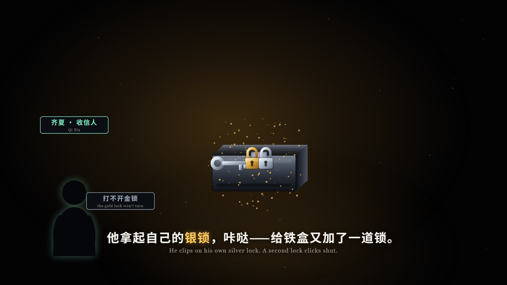
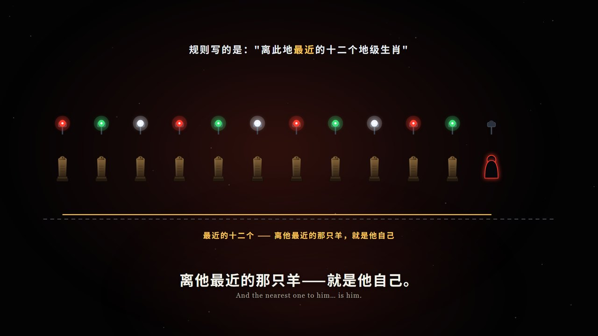
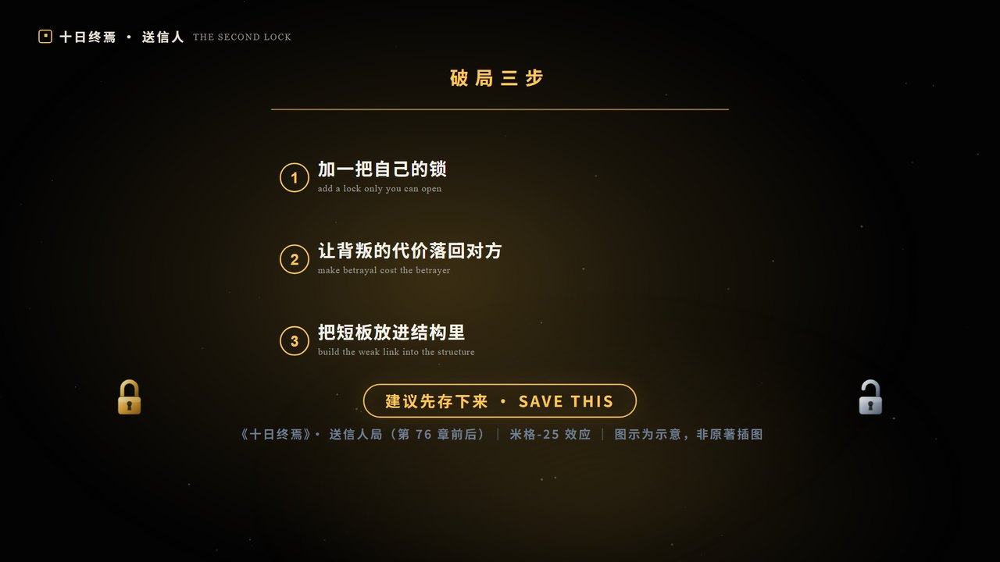

# remotion-beat-video

> 把选题做成 **Remotion 卡点短视频**的完整流水线：从一首 BGM 到「成片 + 封面三版 + 发布包 + 待核事实清单」。
> 1920×1080 / 30fps / 无配音 / 中英双语字幕 / 每句字幕卡在音乐拍点上。

```
BGM ──▶ 节拍分析 ──▶ 选窗口(含静音坎定位) ──▶ 按小节写剧本 ──▶ SVG 零件排画面
                                                              │
     成片.mp4 ◀── 静音自检 ◀── 渲染 ◀── 按调性合成音效 ◀───────┘
        └──▶ 封面 16:9 / 3:4 / 9:16 ──▶ 发布包 ──▶ 待核事实清单
```

## 这是什么

一套**可执行**的短视频制作规范，不是教程：
- **7 个脚本**：抽音轨、节拍分析、能量扫窗、按调性合成音效、成片自检、封面生成、WASM 兜底解码
- **6 篇规范**：版式安全区、剧本结构、音效混音、虚构 IP 核实、封面发布、环境踩坑
- **2 个真实案例**：同一天做出的两条 88–90 秒成片，含决策记录与数据

已用两条真实片子验证（《多出来的一把锁》88.53s、《庄家在号码里》89.43s）。

## 看看它产出什么

| 名场面（双锁铁盒） | 悖论揭晓（庄家在号码里） | 收藏点（三步清单） |
|---|---|---|
|  |  |  |

全部画面由纯 SVG 代码生成，没有任何图片素材 —— 改字幕就是改字符串，重渲一次约 35 分钟。

## 快速开始

**依赖**：Python 3.10+（`numpy`、`Pillow`）、Node 18+、Remotion 4.x、ffmpeg（**可选**，见下）

```bash
# 0) 装依赖（用 npm 或 pnpm 都行；pnpm 记得 rebuild esbuild）
pnpm install && pnpm rebuild esbuild

# 1) 音轨 → 节拍 → 选窗口
python scripts/extract_audio.py 输入.mp4 work/                 # → work/audio.f32 + work/music.mp3
python scripts/analyze_beats.py work/audio.f32 src/beats.json  # BPM / 拍点 / 重拍 / 段落 / 调性
python scripts/scan_energy.py src/beats.json work/audio.f32 --seconds 89
#   ★ 输出 START_BAR / END_BAR 与"静音坎"位置 —— 反转就放坎后第一记重拍

# 2) 按调性合成音效
python scripts/synth_sfx.py src/beats.json public/sfx

# 3) 写剧本（改 src/script.ts 的 subs/cues），先渲静帧自检
node <node> node_modules/@remotion/cli/remotion-cli.js still <Comp> out/s1.png --frame=<场景中点>

# 4) 出片 + 自检
node <node> node_modules/@remotion/cli/remotion-cli.js render <Comp> out/x.mp4 --codec=h264 --crf=18 --concurrency=6
python scripts/check_mp4.py out/x.mp4

# 5) 封面三版
python scripts/make_covers.py --src out/某静帧.png --title 主标题 --out-prefix out/封面_XXX
```

**没有 ffmpeg 也能跑**：`extract_audio.py` 会自动使用 pip 版 `imageio-ffmpeg` 自带的二进制；
`decode_mp3.mjs` 用纯 WASM 解 mp3；`synth_sfx.py` 检测不到 ffmpeg 时会保留 WAV（Remotion 直接读）。

## 目录

```
SKILL.md                     八步流程 · 风格 DNA · 12 条铁律（先读这个）
AGENTS.md                   给 AI 编程助手的入口指令
references/
  pipeline.md                环境、命令、全部踩坑（没有 ffmpeg/scipy/npm 怎么办）
  script-template.md         剧本结构模板 + 拍点换算 + 两集真实时间码
  visual-kit.md              版式安全区、配色、零件清单、动效规范
  sfx-and-mix.md             按调性合成音效、选型表、侧链让位
  fact-check.md              虚构 IP 核实规范 + 可用数据接口
  cover-and-publish.md       封面三版 + 发布包模板 + 24 小时判定
scripts/
  extract_audio.py           mp4/mp3 → f32 + mp3
  analyze_beats.py           BPM/拍点/重拍/段落/调性（纯 numpy）
  scan_energy.py             逐小节能量图 + 推荐窗口 + 静音坎定位
  synth_sfx.py               148 个音效，按 BGM 调性生成
  check_mp4.py               不用 ffprobe 自检成片（时长/轨道/分辨率）
  make_covers.py             16:9 / 3:4 / 9:16 三版封面
  decode_mp3.mjs             纯 WASM mp3 解码兜底
examples/十日终焉-两集.md      真实案例：结构、数据、踩坑
```

## 四个核心概念

| 概念 | 一句话 | 在哪 |
|---|---|---|
| **拍点驱动** | 一小节 = 4 拍；一个场景 4–6 小节；一句字幕 4–5 拍。所有时间码从 BPM 推算，不靠感觉 | `references/script-template.md` |
| **静音坎** | 歌里最安静的那一小节，把它放在窗口 36–46% 处，**反转就压在它之后的第一记重拍** | `scripts/scan_energy.py` |
| **安全区** | 场景元素一律 `y ≤ 850`，字幕在 870–1000，左上抬头 50–95 —— 实测最容易翻车的一条 | `references/visual-kit.md` |
| **收藏点** | 结尾必须是**可截图的清单**（三步/三信号），只给感慨的结尾拿不到收藏 | `SKILL.md` 铁律 4 |

## 使用与标注

**许可**：[MIT](LICENSE) —— 可自由使用、修改、商用，保留版权声明即可。

**引用/致谢**：如果这套流程帮到了你，欢迎在 README 或视频简介里写一句
`基于 remotion-beat-video（MIT）制作`，并附上本仓库链接。

**出处**：本仓库的规范不是凭空写的，是**从两条真实上线的片子里提炼的**——
所有"铁律"都对应一次实际翻车（字体子集缺字、第二支片复用第一支特效导致冲击错位、
Remotion ETA 虚高、字幕压住画面元素…），记录见 `references/pipeline.md` 与 `examples/`。

**二创合规**（重要）：
- 本仓库**不含任何音频、视频、字体或图片素材**，只含代码与文档。
- 分析别人的视频音轨、用平台音乐做 BGM，**仅适合自用学习**；公开发布请使用你拥有授权的音乐，
  并在平台内挂官方曲库/原声卡片。
- 做小说/影视解说时请遵守 `references/fact-check.md` 的三层标注规范，只做**解说与评论**，
  不搬运原文长段，画面自制并标注"图示为示意"。
- 使用 AI 生成内容的平台，发布时请勾选"内容由 AI 生成"。

## 已知限制

- **不产生配音**：本流程是无配音字幕叙事；要旁白需另配 TTS 并对齐。
- **渲染是算力活**：4 核笔记本上 ~1.35 帧/秒，89 秒 1080p 约 **35 分钟**。
- **网络受限环境**下，虚构 IP 的规则细节可能只有二手来源 —— 走待核清单，别硬写。
- 中文字幕默认使用系统字体栈（`Noto Sans SC` / `Microsoft YaHei`），跨机器渲染前请确认字体存在。

## 案例

| 集 | 片名 | 规格 | BGM | 关键决策 |
|---|---|---|---|---|
| 1 | 《多出来的一把锁》 | 88.53s / 97.8 BPM | Clockwork Drop 第 16–52 小节 | 钩子第 1 秒给完整冲突；结尾做"破局三步"收藏点 |
| 2 | 《庄家在号码里》 | 89.43s / 112.5 BPM | We Never (Remix) 第 30–72 小节 | 复用同一首歌的**后半段**；反转压在静音坎后的第一记重拍 |

详见 [`examples/十日终焉-两集.md`](examples/十日终焉-两集.md)。
